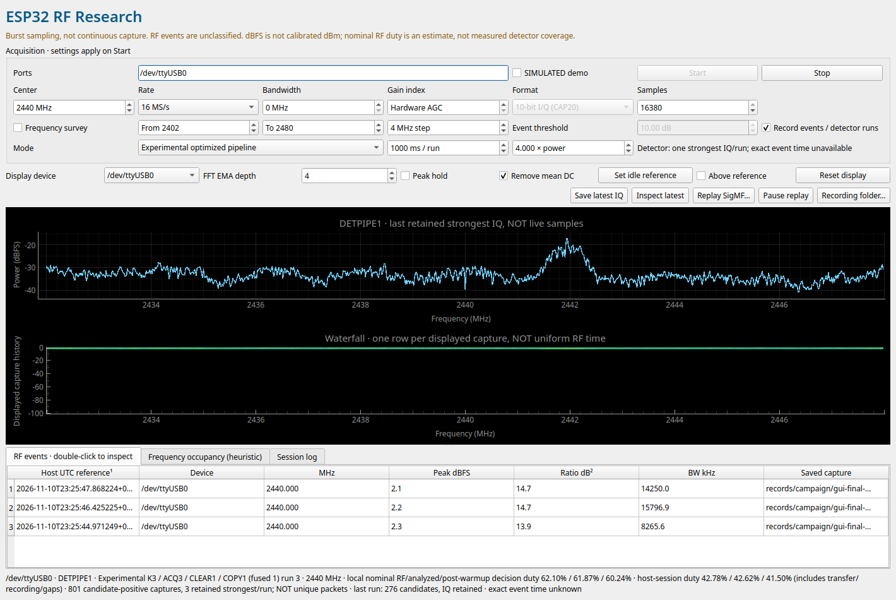

# ESP32 SDR Research Workbench

**A native RF viewer and optimized, burst-aware energy detector for the original ESP32.**

Explore the ESP32 receiver's raw I/Q, inspect spectra and recorded events, and compare honest acquisition duty with end-to-end host coverage. This project builds on [ESPARGOS/esp-sdr](https://github.com/ESPARGOS/esp-sdr), adding a Python/Qt workbench and an experimental guarded acquisition/processing pipeline.

> **Not continuous SDR.** Reception has gaps. Detections are unclassified candidate-positive captures, not decoded packets. Power is relative dBFS, not calibrated dBm.



*Genuine hardware session, not simulated data: original ESP32 over CP2102 UART, 2440 MHz, 16 MS/s, optimized pipeline. The plotted trace is the strongest retained I/Q capture, not a continuous live stream. The screenshot was captured during the final hardware validation; its status line is an intermediate run, not the final benchmark aggregate.*

## What you get

- **Native desktop viewer:** spectrum, capture-index waterfall, frequency survey, heuristic occupancy, event inspection and SigMF replay.
- **Three acquisition modes:** raw snapshots, experimental DET1 and the optimized finite pipeline.
- **Event recording:** structured JSON summaries for every detector run, including no-event runs; CRC-checked SigMF I/Q for the strongest qualifying capture per run.
- **Truthful duty indicators:** local nominal RF, analyzed and post-warmup decision exposure, plus separate host-session values including transfer and recording gaps.
- **Complete firmware source:** guarded memory ownership, exact integer energy processing, overlapping acquisition/processing, fused full-size validation/copy and faster exact CAP20 packing.
- **No automatic flashing:** the viewer does not replace firmware or change operating-system security settings.

## Measured result

On **one ESP32-D0WD-V3 rev. 3.1 with 4 MB flash**, at 2440 MHz, nominal 16 MS/s, 16,380 samples, manual gain index 40, bandwidth setting 12 MHz and a 4× adaptive power threshold:

| Final-image condition | Nominal local RF duty |
| :--- | ---: |
| Legacy DET1 control, no retention | 29.759–29.773% |
| Optimized pipeline, no retention | **62.925–62.958%** |
| Legacy DET1 control, retention enabled | 29.754–29.773% |
| Optimized pipeline, retention enabled | **62.708–62.834%** |

An earlier separately archived DET1 v2 build measured about **32.1%**, so the optimized result is approximately **1.96× the historical nominal listening time**. The same-image control above is reported separately; compiler layout and firmware composition affect timing.

A 24 × 5-second retained-event soak processed **73,745 captures**, with stable heap, no reported errors and valid retained/post-run raw CRC checks in every run. Host-run RF duty was **57.687–57.871%**, including command and retained-I/Q transfer time but excluding the separate raw health checks between runs. Shorter GUI runs have more overhead: five 1-second runs ended around **62.42% local RF duty versus 42.93% host-session RF duty** under the GUI's hardware-gain defaults.

See [validation and limitations](docs/validation.md) for test coverage, negative results and what these numbers do **not** establish.

## Quick start: viewer

Python **3.10+** and a desktop environment are required. Linux was tested; other platforms are not hardware-validated by this project.

```bash
git clone https://github.com/jaykobdetar/esp32-sdr-workbench.git
cd esp32-sdr-workbench
python3 -m venv .venv
source .venv/bin/activate
python -m pip install -e .
./scripts/launch.sh
```

The installed command `esp32-sdr` also launches the viewer. Dependencies are NumPy, SciPy, pyserial, PySide6 and pyqtgraph. `requirements-lock.txt` records the tested host versions; use it when recreating that environment, subject to wheel availability for your Python/platform.

1. Connect a compatible original ESP32 with this project's firmware. Close other serial monitors/viewers first.
2. Select its port, for example `/dev/ttyUSB0`. The tested physical UART runs at **1,000,000 baud**.
3. Start with **2440 MHz**, **16 MS/s**, **16,380 samples** and **Experimental optimized pipeline**. Use a 1-second run for responsive updates; longer finite runs amortize serial transfer overhead.
4. Enable **Record events / detector runs**, then **Start**. Use **Stop** before opening another serial application.
5. Inspect a saved event or replay its SigMF recording. Recordings are local and ignored by Git.

The optimized mode verifies firmware capabilities and exact option readback; it does not silently substitute a different kernel. It selects kernel 3, acquisition option 3, clear option 1 and fused-copy option 1. Raw snapshots and legacy DET1 remain available. The clearly labeled simulated mode is for UI exploration, not performance measurement.

If Linux denies access to the port, arrange serial-device permission using your distribution's documented procedure. Do not run the whole GUI as root. Qt may require your distribution's desktop/XCB libraries; headless systems cannot display the interactive GUI without a display server.

## Build and install firmware

See **[firmware build and flashing](docs/firmware-build.md)** for the pinned ESP-IDF revision, configuration, compilation and deliberate flashing steps. Back up your own device before flashing. Do not use another person's full-flash image, and do not publish backups: they can contain stored settings or credentials.

The optimized path is validated on the **original ESP32 only**, not ESP32-S3/C3/C6 or other family members. Inherited upstream ports remain in the source for completeness, not as a claim of equivalent optimization or validation. The GUI checks capabilities rather than assuming every board implements the same commands.

## How the pipeline works

```text
finite RF acquisition → stop and restore ownership → validate/copy
                                                       ↓
next finite acquisition overlaps exact energy processing of the prior private copy
                                                       ↓
run summary + optional strongest capture → CRC-checked serial transfer → viewer
```

Full aperture bounds/sentinels, receiver restoration and immutable-copy ownership remain enforced. The pipeline does not read the aperture while RF owns it. Incomplete 64-sample tails and the first 16 warmup captures do not contribute to decision exposure. Faster cadence changes which RF windows are observed and how the per-capture adaptive background evolves in wall time.

## Scope and limitations

- Duty is `successful samples / configured sample rate / complete run wall time`, a **nominal aperture estimate**, not externally measured RF arrival coverage.
- Only one board was benchmarked. Independent multi-port viewing is not synchronized multi-board coverage.
- No packet decoder, packet recovery rate, calibrated sensitivity, false-positive guarantee or exact RF event timestamps are provided.
- A candidate count can include multiple positive captures of the same transmission. Only the strongest qualifying I/Q capture per detector run is retained.
- The waterfall advances per displayed capture, not uniform RF time. UART transfer adds substantial gaps.
- BLE OFF/ON validation was inconclusive in ambient RF; no ground-truth transmitted packet count/timing was available.
- Undocumented receiver/debug behavior is experimental. Use only on hardware and signals you are authorized to investigate; respect applicable radio/privacy laws.

## Repository layout

```text
firmware/       Complete optimized firmware source and build configuration
sdr_research/   Native viewer, protocol, processing and recording code
scripts/        Portable viewer launcher
tests/         Small selected regression suite (not the entire research archive)
docs/           Build guide, genuine screenshot and validation summary
```

This public release intentionally excludes original device flash/NVS, recovery images, personal machine configuration, raw RF recordings, large campaign logs and superseded experimental firmware trees. The full private research originals are preserved separately.

## Attribution

Receiver firmware derives from **[ESPARGOS/esp-sdr](https://github.com/ESPARGOS/esp-sdr)** at upstream commit `a8eaac1758d7567be9d6e82698f36f025573cb62`. Its license and notices are retained in `firmware/`. This repository is an independent experimental extension, not an official ESPARGOS release. See the firmware build guide for third-party requirements and provenance.

## License

GPL-3.0-or-later; see [LICENSE](LICENSE). Upstream notices are retained. Vendored ESP-DSP remains Apache-2.0 under its own notices. ESP-IDF and its toolchain are external dependencies under their respective licenses. This release contains source, not proprietary vendor radio-library binaries or device flash dumps.

## Run selected tests

```bash
python -m pip install -e ".[test]"
QT_QPA_PLATFORM=offscreen python -m pytest -q
```

The selected viewer regression suite passed **147 tests** against this public source copy. These software tests require no connected board and are not a replacement for hardware validation. Firmware checks are documented in the build guide.
