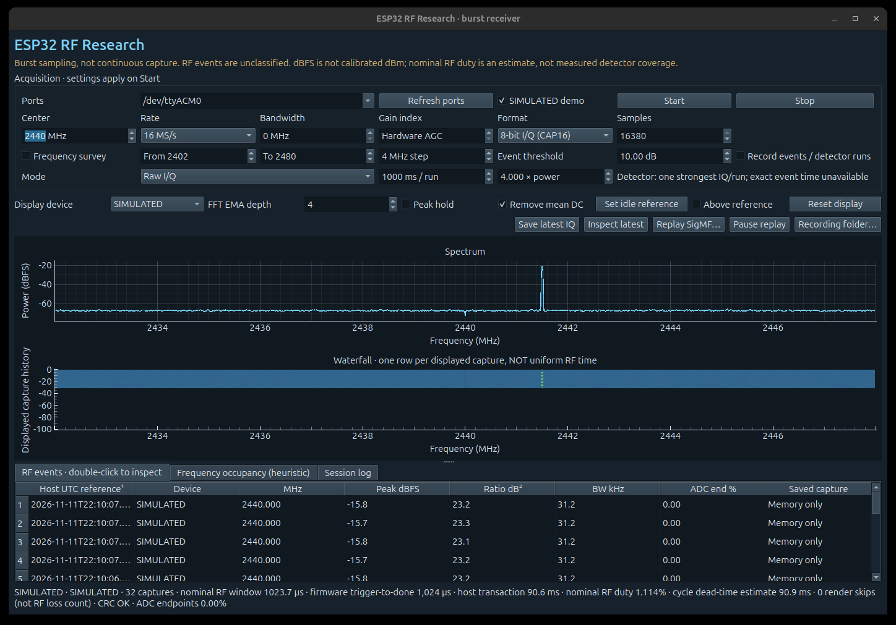

# ESP32 SDR Research Workbench

**A native RF viewer and optimized, burst-aware energy detector for the original ESP32.**

Explore the ESP32 receiver's raw I/Q, inspect spectra and recorded events, and compare honest acquisition duty with end-to-end host coverage. This project builds on [ESPARGOS/esp-sdr](https://github.com/ESPARGOS/esp-sdr), adding a Python/Qt workbench and an experimental guarded acquisition/processing pipeline.

> **Not continuous SDR.** Reception has gaps. Detector counts are unclassified candidate-positive captures, not decoded packets. A separate offline decoder validates only the controlled known Nordic test frames. Power is relative dBFS, not calibrated dBm.



*Actual `scripts/launch.sh --demo` window, captured on 11 November 2026 with the launcher's dark palette and the ADC-endpoint event column. The checked SIMULATED demo control, device names and status label identify synthetic raw I/Q. This screenshot demonstrates the UI, not receiver performance or new RF evidence. The historical hardware screenshot remains archived as `docs/viewer-hardware.png`.*

## Firmware status

The headline duty benchmarks below belong to **optimized-v2**, which is also the image installed on the test board. Later images change the detector and add safety fixes, but none has shown a retained-packet advantage over v2.

| Image | What it adds | Evidence from the board |
|---|---|---|
| `optimized-v2` | The measured reference ([tagged source](docs/measured-v2-source.md)) | Benchmark, soak and controlled-source campaigns below |
| `adaptive-q16-v3`, released | Q16 background rule, optional three-crop retention, gain and trigger telemetry | Matched source-on/off trials against v2 at two source powers; in the stronger set, one verified packet on v2 against none on v3 ([evaluation](docs/evidence/adaptive-evaluation/evaluation-report.md)) |
| `adaptive-q16-v3`, instrumented | Tie-retention fix and heap/stack telemetry | Boundary matrix and a 30-minute soak (same evaluation) |
| `adaptive-q16-v4` | Tie fix in the release source, read-only calibration fingerprint | Short passive smoke check ([follow-up](docs/review-follow-up.md)) |
| `adaptive-q16-v5`, `v6` | NVS preserved on startup failure, strict `SPEC` parsing, NUL rejection | Short passive smoke checks ([review fixes](docs/safety-review-fixes.md)) |
| `adaptive-q16-v7` | [Selectable background rule](docs/adaptive-detector.md#comparing-the-two-rules-on-one-image); idles instead of rebooting on NVS failure | 984-run exact-release campaign, 30-minute soak and same-image rule comparison ([v7 evaluation](docs/evidence/v7-evaluation/README.md)) |
| `adaptive-q16-v8` (current source) | Rejects the malformed selector text that v7 accepted on the board | **None.** Compiled in CI and host-tested only |

Two cautions apply to every comparison between images: they were run in sequence, and the stored PHY calibration changed at an unknown point during the v3 evaluation. V7's rule selector removes both for the background rule: run on one image in one session, the old and new rules gave similar source-associated candidate rates, and neither retained more packets ([what the board showed](docs/adaptive-detector.md#what-the-board-showed)). The [remaining-validation guide](docs/remaining-validation-guide.md) covers the outstanding bench work, and the [calibration guide](docs/calibration-fingerprints.md) the boundary logging for future campaigns.

## What you get

- **Native desktop viewer:** spectrum, capture-index waterfall, frequency survey, heuristic occupancy, event inspection and SigMF replay.
- **Three acquisition modes:** raw snapshots, experimental DET1 and the optimized finite pipeline.
- **Headless recorder:** `esp32-sdr record` saves bounded or unattended sessions without Qt, with atomic final summaries and graceful stop signals. [Guide](docs/headless-recording.md).
- **Event recording:** structured JSON summaries for every detector run, including no-event runs and the requested gain mode, gain index and bandwidth; CRC-checked SigMF I/Q for the strongest qualifying capture per run.
- **Saturation indicator:** every displayed or recorded capture reports the share of samples sitting on an ADC endpoint code, and 1% or more is flagged as likely clipping.
- **Truthful duty indicators:** local nominal RF, analyzed and post-warmup decision exposure, plus separate host-session values including transfer and recording gaps.
- **Complete firmware source:** guarded memory ownership, exact integer energy processing, overlapping acquisition/processing, fused full-size validation/copy and faster exact CAP20 packing.
- **No automatic flashing:** the viewer does not replace firmware or change operating-system security settings.

## Offline RF analysis

For new campaign summaries, use the [version 2 offline analysis guide](docs/offline-rf-analysis-v2.md).
It includes passed no-retention runs in denominators, distinguishes missing IQ analysis,
and validates current capture metadata. Historical scripts and evidence remain unchanged.

## Measured result

On **one ESP32-D0WD-V3 rev. 3.1 with 4 MB flash**, at 2440 MHz, nominal 16 MS/s, 16,380 samples, manual gain index 40, bandwidth setting 12 MHz and a 4× adaptive power threshold:

| Final-image condition | Nominal local RF duty |
| :--- | ---: |
| Legacy DET1 control, no retention | 29.759–29.773% |
| Optimized pipeline, no retention | **62.925–62.958%** |
| Legacy DET1 control, retention enabled | 29.754–29.773% |
| Optimized pipeline, retention enabled | **62.708–62.834%** |

An earlier separately archived DET1 v2 build measured about **32.1%**, so the optimized result is approximately **1.96× the historical nominal listening time**. The same-image control above is reported separately; compiler layout and firmware composition affect timing.

A 24 × 5-second retained-event soak processed **73,745 captures**, with stable heap, no reported errors and valid retained/post-run raw CRC checks in every run. Host-run RF duty was **57.687–57.871%**, including command and retained-I/Q transfer time but excluding the separate raw health checks between runs. Shorter GUI runs have more overhead: five 1-second runs ended around **62.42% local RF duty versus 42.93% host-session RF duty** under the GUI's hardware-gain defaults. The 62.42% is the last run's local value; 42.93% is cumulative session duty.

See [validation and limitations](docs/validation.md) for test coverage, negative results and what these numbers do **not** establish. The [published evidence](docs/evidence/README.md) includes all 12 A/B summaries, 24 soak runs with heap replies, five GUI summaries, historical baseline trials, build identity and microbenchmarks. Recalculate the headline numbers offline with `python3 scripts/verify_evidence.py`.

## Controlled-source validation: 11 November 2026

The new [nRF52840 transmitter and guarded application updater](nrf52840-transmitter/README.md) support reproducible known-packet tests. [Full results and limits](docs/nrf-validation-summary.md) distinguish energy detection, transport integrity and over-air packet validation.

- **550 controlled I/Q recordings** passed recorded UART transport CRC checks. **25 files** contained at least one complete known address/payload/RF-CRC frame. These are artifact counts, not packet recall.
- Actual-image ABAB trials measured **32.11% historical vs 62.33% optimized nominal local RF duty**, and approximately **102 additional source-dependent candidate windows/s** for optimized firmware after OFF subtraction. Candidate windows are not distinct packets.
- Retaining only one strongest candidate remains a bottleneck. The separate reservoir trial (**3/12 vs 2/12 ON buffers**) did not demonstrate superiority, so it is an [optional source patch](experiments/retention/README.md), not the default.
- Only one receiver was available. No calibrated sensitivity, continuous reception, synchronized multi-receiver coverage or Quest protocol decoding is established.

[Scrubbed campaign data, source hashes and verified known-packet bytes](docs/evidence/nrf-validation/README.md) are public. Raw RF recordings, recovery flash and device identifiers are excluded. Recompute campaign totals, duty/rate comparisons and known-packet CRCs without hardware:

```sh
python3 scripts/verify_nrf_evidence.py
```

The [campaign guide](docs/nrf-controlled-source-campaign.md) covers new measurements using explicit device ports and your own verified receiver binary. The [current offline analyzer](scripts/analyze_nrf_iq_v2.py) works on privately held originals, with [manifest-first summaries and explicit input limits](docs/offline-rf-analysis-v2.md); the public summary alone cannot replay RF demodulation. The frozen analyzer and summaries without a `_v2` suffix are for historical reproduction only; they retain the documented missing-run and metadata limitations. The [multi-receiver coordinator](docs/multi-receiver-preparation.md) has fake-device tests and a historical one-receiver health check, not a two-receiver experiment.

The subsequent [matched AGC/manual comparison](docs/matched-gain-comparison.md) completed 24 bounded runs on the unchanged installed firmware at −20 dBm. Candidate rates depended strongly on gain, but four-block variability does not establish packet-detection superiority. Geometry remains unmeasured.

## Adaptive-v3 evaluation: 11–12 November 2026

- **925 pipeline runs, 1,568,533 processed captures and 1,818 saved I/Q files** with recorded valid transport CRCs. Ten passive runs retained no event; those are not CRC failures.
- The separate instrumented, tie-fixed candidate completed 360 five-second soak runs. Its lowest recorded DMA-capable heap minimum was 30,448 bytes and command-task lifetime free-stack watermark was 2,748 bytes. The unchanged released-v3 binary did not receive that soak.
- Stronger-source retained full-packet results were 1/8 ON runs for v2 hardware AGC and 0/8 in every other image/retention/gain stratum. Sparse packet recovery does not establish superiority. Energy candidate counts are not received packets.
- The tie fix preserves earlier generations among equal lowest scores. All 4,096 six-capture score streams agree with stable reference ordering after the fix.
- Stored PHY calibration differed in 173/1,904 bytes; its original change timing/trigger is unknown. A [separate v2-only follow-up](docs/evidence/adaptive-evaluation/calibration-follow-up.md) reproduced conditional refresh without v3. Calibration still confounds sequential RF comparisons. The restored v2 application was verified, but original calibration bytes were not restored.

[Report, public summaries and provenance](docs/evidence/adaptive-evaluation/README.md).
Raw I/Q, device identities and flash/NVS bytes remain private. The offline checker
recomputes public summary arithmetic, not waveform decoding or new hardware observations:

```sh
python3 scripts/verify_adaptive_evidence.py
```

## Quick start: viewer

Python **3.10+** and a desktop environment are required. Linux was tested; other platforms are not hardware-validated by this project.

```bash
git clone https://github.com/jaykobdetar/esp32-sdr-workbench.git
cd esp32-sdr-workbench
python3 -m venv .venv
source .venv/bin/activate
python -m pip install -e .
./scripts/launch.sh
```

The installed command `esp32-sdr` also launches the viewer. Dependencies are NumPy, pyserial, PySide6 and pyqtgraph. On Python 3.10 and 3.11 the install deliberately selects PySide6 older than 6.12: PySide6 6.12.0 aborts the viewer within seconds on those interpreters, and is only safe on Python 3.12 or newer. `requirements-lock.txt` records the tested host versions; use it when recreating that environment, subject to wheel availability for your Python/platform.

1. Connect a compatible original ESP32 with this project's firmware. Close other serial monitors/viewers first.
2. Select its port, for example `/dev/ttyUSB0`. The tested physical UART runs at **1,000,000 baud**.
3. Start with **2440 MHz**, **16 MS/s**, **16,380 samples** and **Experimental optimized pipeline**. Use a 1-second run for responsive updates; longer finite runs amortize serial transfer overhead.
4. Enable **Record events / detector runs**, then **Start**. Use **Stop** before opening another serial application.
5. Inspect a saved event or replay its SigMF recording. Recordings are local and ignored by Git.

The optimized mode verifies firmware capabilities and exact option readback; it does not silently substitute a different kernel. It selects kernel 3, acquisition option 3, clear option 1 and fused-copy option 1. Raw snapshots and legacy DET1 remain available. The clearly labeled simulated mode is for UI exploration, not performance measurement.

If Linux denies access to the port, arrange serial-device permission using your distribution's documented procedure. Do not run the whole GUI as root. Qt may require your distribution's desktop/XCB libraries; headless systems cannot display the interactive GUI without a display server.

## Build and install firmware

See **[firmware build and flashing](docs/firmware-build.md)** for the pinned ESP-IDF revision, configuration, compilation and deliberate flashing steps. Back up your own device before flashing. Do not use another person's full-flash image, and do not publish backups: they can contain stored settings or credentials.

The optimized path is validated on the **original ESP32 only**, not ESP32-S3/C3/C6 or other family members. Inherited upstream ports remain in the source for completeness, not as a claim of equivalent optimization or validation. The GUI checks capabilities rather than assuming every board implements the same commands.

## How the pipeline works

```text
finite RF acquisition → stop and restore ownership → validate/copy
                                                       ↓
next finite acquisition overlaps exact energy processing of the prior private copy
                                                       ↓
run summary + optional strongest capture → CRC-checked serial transfer → viewer
```

Full aperture bounds/sentinels, receiver restoration and immutable-copy ownership remain enforced. The pipeline does not read the aperture while RF owns it. Incomplete 64-sample tails and the first 16 warmup captures do not contribute to decision exposure. Faster cadence changes which RF windows are observed and how the per-capture adaptive background evolves in wall time.

## Scope and limitations

- Duty is `successful samples / configured sample rate / complete run wall time`, a **nominal aperture estimate**, not externally measured RF arrival coverage.
- Only one board was benchmarked. Independent multi-port viewing is not synchronized multi-board coverage.
- The offline decoder is limited to the controlled unwhitened Nordic test framing. No general protocol/Quest decoder, packet recall estimate, calibrated sensitivity, false-positive guarantee or exact RF event timestamps are provided.
- A candidate count can include multiple positive captures of the same transmission. Only the strongest qualifying I/Q capture per detector run is retained.
- The waterfall advances per displayed capture, not uniform RF time. UART transfer adds substantial gaps.
- BLE OFF/ON validation was inconclusive in ambient RF; no ground-truth transmitted packet count/timing was available.
- The detector flags a large and variable share of captures. In the [published runs](docs/evidence/README.md), 5–31% of post-warmup captures were candidate-positive in the manual-gain A/B trials, 6–48% in the soak and 38–47% in the hardware-AGC GUI runs. The [controlled-source trials](docs/controlled-rf-analysis.md) show that part of this responds to a real transmitter: the optimized image flagged about 427–438 candidate windows/s with the known source on, against 193–202/s with it off. The source-off rate is ambient activity plus any false alarms, and no terminated-input run exists to separate the two.
- Historical optimized-v2 updates its background only on captures that are *not* flagged, so a sustained rise can remain latched until the next run. Adaptive-v3 updates Q16 background on every capture, more slowly on positives. This removes that synthetic latch but does not establish higher packet yield.
- Energy is measured in ADC units. Under hardware AGC the firmware does not report the gain in use, so energies are not comparable across gain steps; under manual gain index 40 the recorded background was only 2–34 ADC² units, where integer rounding of the background is coarse.
- Reported dBFS is relative to one full-scale component, so a complex sample can read up to +3 dBFS. Values near or above 0 dBFS, or a flagged ADC-endpoint share, mean the capture is at the converter's rails.
- The screenshot-session retained captures have Q-component endpoint occupancy of 0.20–12.76%, consistent with a saturation/clipping concern. [Published counts](docs/evidence/gui/clipping-counts.json) do not establish its cause. A later manual gain sweep against the controlled source found gain index 60 usable and up to 10% component clipping at index 80; later matched gain and adaptive-image trials are linked above, but neither establishes a general gain ranking; no terminated-input run exists.
- Undocumented receiver/debug behavior is experimental. Use only on hardware and signals you are authorized to investigate; respect applicable radio/privacy laws.

## Repository layout

```text
firmware/       Complete optimized firmware source and build configuration
sdr_research/   Native viewer, protocol, processing and recording code
scripts/        Launcher, campaigns, offline analysis, evidence checks; see scripts/README.md
nrf52840-transmitter/  Controlled transmitter source and guarded updater
experiments/    Optional unadopted retention patch
tests/          Offline regression tests (not the entire research archive)
docs/           Guides, protocol, validation records; see docs/README.md for an index
docs/evidence/  Curated benchmark summaries, build identity and diagnostic sources
.github/        CI: lint, format check and the host test suites
```

Historical lab clients (`profiling.py`, `pipeline_profile.py`, `validate_copy.py`), other-chip backends and vendored ESP-DSP are kept deliberately; see [diagnostic provenance](docs/diagnostic-provenance.md). The serial commands the release firmware answers are described in [the protocol document](docs/protocol.md).

This public release intentionally excludes original device flash/NVS, recovery images, personal machine configuration, raw RF recordings, large uncurated campaign logs and complete superseded experimental firmware trees. A curated sanitized evidence supplement and small, explicitly historical diagnostic source selections are included under `docs/evidence/`. The full private research originals are preserved separately.

## Attribution

Receiver firmware derives from **[ESPARGOS/esp-sdr](https://github.com/ESPARGOS/esp-sdr)** at upstream commit `a8eaac1758d7567be9d6e82698f36f025573cb62`. Its license and notices are retained in `firmware/`. This repository is an independent experimental extension, not an official ESPARGOS release. See the firmware build guide for third-party requirements and provenance.

## License

GPL-3.0-or-later; see [LICENSE](LICENSE). Upstream notices are retained. Vendored ESP-DSP remains Apache-2.0 under its own notices. ESP-IDF and its toolchain are external dependencies under their respective licenses. This release contains source, not proprietary vendor radio-library binaries or device flash dumps.

## Run selected tests

```bash
python -m pip install -e ".[dev]"
ruff check . && ruff format --check .
QT_QPA_PLATFORM=offscreen python -m pytest -q
```

Plain `pytest` runs the viewer, evidence and campaign tests in `tests/`, the receiver host tests in `firmware/tests/` and the transmitter host tests in `nrf52840-transmitter/tests/`: **610 tests plus 5 subtests** at the v8 source. The C checks need a host compiler with UndefinedBehaviorSanitizer, and the retention-patch test also needs `git`. [CI](.github/workflows/ci.yml) runs the lint, the format check and all three suites on Python 3.10 and 3.13 for every push and pull request. These software tests require no connected board and are not a replacement for hardware validation: separate [firmware CI](.github/workflows/firmware.yml) compiles ESP32 and nRF52840 source but does not operate hardware. Qt needs the system EGL/XCB libraries even for offscreen runs (`libegl1` on Debian/Ubuntu). Some campaign and analysis sources are deliberately left unformatted; the [script index](scripts/README.md) explains why.
