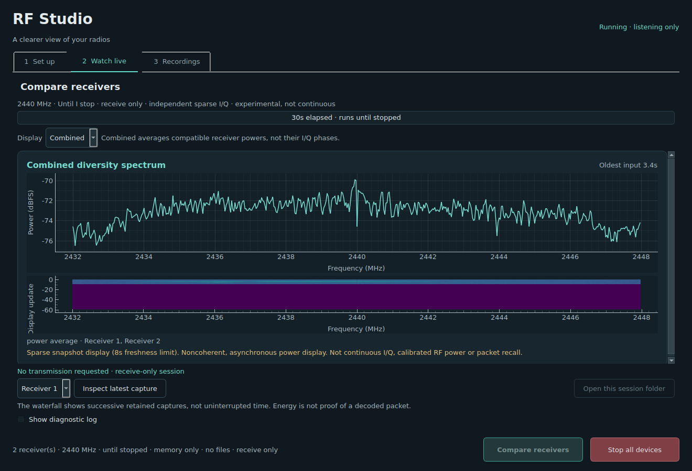

# Dual-receiver streaming evaluation

This evidence accompanies the experimental persistent detector stream and sparse
I/Q transfer work. **It does not demonstrate continuous RF capture, 100% packet
recall, coherent I/Q combining, or Quest-controller protocol compatibility.**

The measurements below are intermediate candidates, not interchangeable results
for the current source tree. Each data set has its own measured application hash,
build-source commit and firmware variant in [summary.json](summary.json).

## Read the three time measurements separately

1. **Requested-window nominal union:** union of each recorded trigger timestamp
   plus `16380 / 16 MHz`, over the requested receiver-A observation interval.
   Shared, known, CRC-valid RF packets align the independent clocks. This is a
   timing model, not a calibration of the usable ADC aperture.
2. **Completion-inclusive nominal union:** the same model, but the denominator
   extends to the later receiver terminal timestamp and therefore includes final
   snapshot/telemetry drain. It still excludes external RF-anchor calibration,
   host pre-arm time, terminal-frame transmission and trailing ASCII output.
   It is **not** a complete host-session metric.
3. **Full-burst opportunity:** packet-start times for which an entire hypothetical
   50/100/250/500 µs burst could fit in *one* nominal capture. Overlapping partial
   captures are not stitched together. The denominator is the requested interval
   shortened by the burst duration. This does not imply that those captures were
   retained, that a packet was present, or that it could be decoded.

Adding receiver duties is not a union measurement. Likewise, a nominal timeline
union near 100% can still have substantially fewer opportunities for a complete
packet to fit inside one receiver's buffer.

## Intermediate candidate comparisons

Ranges below are across the listed runs, rounded from the reproducible evidence.
The source is stopped during no-retention timing runs. Sparse campaigns include
alternating transmitter ON/OFF runs and retain full buffers independently of the
energy-positive detector flag.

| Data set / measured candidate | Runs | Requested-window union | Completion-inclusive union | Largest requested-window gap | 100 µs full-burst opportunity |
|---|---:|---:|---:|---:|---:|
| `campaign-r7`, stream v7, 1.875 ms period, no raw retention | 3 × 30 s | 99.960–99.969% | 99.953–99.961% | 724–851 µs | 98.418–98.432% |
| `campaign-r7-1800`, same binary, 1.800 ms period | 3 × 60 s | 99.565–99.630% | 99.561–99.627% | 776–837 µs | 99.341–99.433% |
| `sparse1-onoff`, sparse v1, one IQ frame pumped per cycle | 4 × 30 s | 99.752–99.760% | 97.064–97.072% | 851–1,006 µs | 98.114–98.195% |
| `sparse2-guard-timing`, sparse v2 adaptive guard, no raw retention | 2 × 60 s | 99.680–99.688% | 99.677–99.685% | 715–742 µs | 98.068–98.079% |
| `sparse3-onoff`, sparse v3, fuller UART budget plus adaptive guard | 2 × 30 s | 98.833–98.854% | 96.849–96.869% | 851–884 µs | 95.523–97.104% |

The shorter period improved the modeled 100 µs full-burst opportunity but worsened
timeline union in these trials. The adaptive maximum-delay guard caused frequent
forced tick waits and was rejected as the preferred scheduler. The v3 transfer
change eliminated busy-snapshot skips in its two trials, but its combination with
that guard and more frequent packing worsened timing. **None of these tradeoffs
is evidence of a universally better receiver.** Later scheduler candidates must
be evaluated separately rather than assigned these numbers.

Early streaming candidates also experienced incomplete final ASCII summaries
after valid binary telemetry. Those trials were failures, not coverage evidence.
Paced summary output and immediate-command handoff changes were screened before
these accepted campaigns. The exact USB/serial truncation mechanism was not
established; the workaround is empirical.

The old finite-run result around 96.25% had different timing boundaries and
readout/restart behavior. Do not directly compare it with a requested-window
99.75% figure or describe that as an equal-duration end-to-end improvement.

<!-- LATER-CANDIDATES -->
## Later candidate measurements

| Data set | Runs | Requested-window union | Completion-inclusive union | Largest requested-window gap | 100 µs full-burst opportunity |
|---|---:|---:|---:|---:|---:|
| `sparse4-idle1875` | 3 × 30 s | 98.970–99.740% | 98.963–99.730% | 596–788 µs | 97.078–98.036% |
| `sparse4-idle1875-repeat` | 3 × 30 s | 98.977–99.573% | 98.969–99.563% | 717–1112 µs | 97.086–97.826% |
| `sparse5-wake1875` | 2 × 60 s | 99.965–99.967% | 99.962–99.965% | 259–265 µs | 98.355–98.385% |
| `sparse5-wake1800` | 2 × 60 s | 99.132–99.927% | 99.129–99.924% | 312–929 µs | 98.660–99.669% |
| `sparse5-onoff` | 2 × 30 s | 99.492–99.515% | 97.493–97.517% | 851–921 µs | 97.830–97.881% |
| `sparse6-onoff` | 4 × 30 s | 99.920–99.936% | 97.902–97.921% | 386–610 µs | 98.399–98.424% |

Both sparse-v4 data sets actually used a **1.875 ms** period. The repeat was
renamed to correct an initial filename; the saved configuration is authoritative.
V4’s idle-hook handshake alone did not establish a stable improvement. V5 used
the separately capability-gated wake-assisted selector (phase 34). Its shorter
1.800 ms trial was variable, so the best individual result is not a consistency
or superiority claim.

**`sparse5-onoff` was interrupted after two complete recorded runs.** Its campaign
status is explicitly `interrupted`, not successful. The two saved rows have
complete CRC-checked telemetry, bracketing anchors and independently rechecked
saved snapshots, and are reported only as completed per-run evidence. Offline
recovery of their recordings found 18 distinct verified packets in the ON row
(8 from A, 10 from B) and none in the OFF row; each row has 15 + 16 recordings.
This equals the v3 ON union in a different schedule, not proof that v5 is better.
The original campaign has no final-cleanup record. A separate later recovery
check found both receivers responsive and the transmitter healthy and stopped.

### Decision-valid interval union

The detector’s first 16 captures are warmup, and its block kernel uses 16,320
of the 16,380 samples. The following requested-window union excludes warmup
and that unused tail. “Decision-valid” does not mean energy-positive, a detected
packet, retained I/Q, or a decoded packet.

| Data set | Nominal decision-valid union |
|---|---:|
| `campaign-r7` | 99.858–99.867% |
| `campaign-r7-1800` | 99.512–99.578% |
| `sparse1-onoff` | 99.649–99.658% |
| `sparse2-guard-timing` | 99.624–99.632% |
| `sparse3-onoff` | 98.717–98.741% |
| `sparse4-idle1875` | 98.854–99.632% |
| `sparse4-idle1875-repeat` | 98.860–99.463% |
| `sparse5-wake1875` | 99.912–99.915% |
| `sparse5-wake1800` | 99.070–99.873% |
| `sparse5-onoff` | 99.384–99.407% |
| `sparse6-onoff` | 99.818–99.835% |

### Measured source identities

Application hashes below are prefixes for scanning; [summary.json](summary.json)
contains the full SHA-256 and pinned ESP-IDF commit. A source tree at a later
commit must not inherit measurements from an earlier binary.

| Firmware variant suffix | Build-source commit | Application SHA-256 prefix |
|---|---|---|
| `esp32-dual-stream-experimental-v7` | `39eb09a94b5fad8f97294dd9b2d9cfbc285525a6` | `10d2a338e7f59934` |
| `esp32-dual-sparse-iq-experimental-v1` | `0c9841e9d324bb42ca0f0b5ba9b4ec209bb49a2c` | `fa9de0081f188ef5` |
| `esp32-dual-sparse-iq-experimental-v2` | `38af18b74b0e46a6189dc10aee954c19d883e61a` | `78de65ab275c3602` |
| `esp32-dual-sparse-iq-experimental-v3` | `bf1421d51614443828756f26219c9e83fa5cf4a6` | `b12373208611e557` |
| `esp32-dual-sparse-iq-experimental-v4` | `4fe0fcdfa8f6c028b807c1a8c6574fa9d82b4241` | `d7c8036ccc187cdc` |
| `esp32-dual-sparse-iq-experimental-v5` | `1bf6c58edfaede75ee8f4c9be295255c5334111e` | `a400a6339e7ee6c7` |
| `esp32-dual-sparse-iq-experimental-v6` | `4215aedd40e954ffa107681cedffadb0356cbec2` | `e17231679f6125b3` |

### Bounded v5 transport and memory screening

[sparse5-screening.json](sparse5-screening.json) preserves sanitized summaries
for 12 paired four-second runs: **51,143 captures and 72 complete sparse buffers**
passed the screening script’s transport checks. The lowest reported free local
heap was 26,224 bytes and stack headroom was 2,924 bytes. Both cooperative STOP
tests returned status 3. These are bounded screening results, not lifetime
stability, a long-duration soak, or packet-decoding counts.

<!-- END-LATER-CANDIDATES -->


## Actual known-packet evidence

[packet-proof.json](packet-proof.json) contains only complete, known generated
payloads with address and over-air CRC verification. Partial decoder candidates,
incidental RF samples, raw recordings and device identifiers are excluded.

| Candidate / source state | Sparse recordings A + B | Distinct packets A | Distinct packets B | Combined distinct packets |
|---|---:|---:|---:|---:|
| Sparse v1, ON run 0 | 8 + 8 | 4 | 4 | 8 |
| Sparse v1, OFF run 1 | 8 + 8 | 0 | 0 | 0 |
| Sparse v1, OFF run 2 | 8 + 8 | 0 | 0 | 0 |
| Sparse v1, ON run 3 | 8 + 8 | 3 | 5 | 8 |
| Sparse v3, ON run 0 | 15 + 16 | 8 | 10 | 18 |
| Sparse v3, OFF run 1 | 15 + 16 | 0 | 0 | 0 |
| Sparse v5, ON run 0 (interrupted campaign) | 15 + 16 | 8 | 10 | 18 |
| Sparse v5, OFF run 1 (interrupted campaign) | 15 + 16 | 0 | 0 | 0 |
| Sparse v6, ON run 0 | 15 + 16 | 8 | 10 | 18 |
| Sparse v6, OFF run 1 | 15 + 16 | 0 | 0 | 0 |
| Sparse v6, OFF run 2 | 15 + 16 | 0 | 0 | 0 |
| Sparse v6, ON run 3 | 15 + 16 | 9 | 11 | 20 |

Deduplication is **within one transmitter START only**. Sequence numbers can be
reused in another run and must not be merged across runs. In these ON runs the
receivers contributed different packets; combined counts therefore exceeded
those of either receiver. This is useful temporal diversity in sparse recordings,
not a packet-recall percentage, a matched sensitivity comparison, or coherent
combining. Zero matches in these OFF controls is a finite observation, not proof
of a zero false-positive rate. ON/OFF order was alternated, not randomized.

The source used known 16-byte payloads, 2 Mbps GFSK at 2440 MHz, nominal 0 dBm,
1 ms packet interval with 113 µs configured jitter. Receivers used manual gain 60,
16 MS/s, 16,380 samples, 10-bit components and legacy background policy. Antenna
geometry and absolute received power were not measured, so these are not
sensitivity or distance specifications.

## Reproduce the published checks

From an installed checkout with transmitter extras:

```sh
python -m nrf_campaigns.verify_stream_evidence docs/evidence/dual-stream-evaluation
python -m nrf_campaigns.verify_sparse_packet_evidence docs/evidence/dual-stream-evaluation/packet-proof.json
```

From the source checkout, `python -m scripts.…` is also supported. These commands
are offline and do not connect to radios or transmit.

The timing verifier checks archive SHA-256 values, original per-frame wire CRCs,
sequence/counter/terminal consistency, independent bracketing RF-anchor groups,
clock-fit and held-out screens, then recomputes interval unions and sensitivities.
The packet verifier recomputes the known payload and Nordic over-air CRC from the
published decoded bytes, then recomputes per-run unions. **It cannot repeat raw
I/Q demodulation because raw RF is intentionally private.** Transport CRC and
radio CRC are different checks.

The archive manifest hashes and wire CRCs detect corruption; they are not
cryptographic attestation of the measurement hardware or clock model.

## Timing uncertainty and remaining limits

- Each accepted fit requires at least three independent capture-pair groups on
  each side of the requested interval. Whole groups are held out for validation.
- Affine clock-fit residuals and held-out errors are empirical diagnostics, not
  certified bounds on clock behavior inside the run. Nonlinear drift between
  anchors can remain undetected.
- ±1/5/20 µs clock-shift scenarios and eroded-aperture scenarios are published as
  **assumption-based sensitivity analyses**, not confidence intervals.
- Packet opportunity uses nominal sample rates and trigger timestamps. ADC
  settling, capture-boundary validity, RF calibration changes and finite decoder
  performance still matter.
- Full-rate raw I/Q is approximately 40 MB/s at these settings, far above the
  roughly 100 kB/s wire capacity of a 1 Mbaud 8N1 link. Sparse snapshots are not a
  continuous waveform, regardless of the acquisition-window union.
- RF Studio's combined spectrum is an asynchronous, noncoherent power display.
  Its independently started streams are not automatically aligned by this RF
  calibration campaign and must not inherit the campaign's coverage figures.

Firmware images and flash backups are not part of this evidence. Preserve each
board's recovery image and verify its partition layout before flashing; identical
USB serial labels do not imply identical application offsets.

### Bounded v6 transport screening

[sparse6-screening.json](sparse6-screening.json) records 12 paired four-second
runs with 51,216 captures and 72 complete sparse buffers passing transport checks,
plus successful cooperative STOP tests. Lowest reported free local heap was
26,044 bytes and stack headroom was 2,924 bytes. In this short screening, the
reported skipped-slot count was zero rather than the three per receiver/run
seen in v5's screening. This is a bounded scheduling observation, not proof of
100% reception or general performance superiority. The exact tested v6 application
hash and original build commit are retained; the integration commit has identical
firmware source but is not substituted for the build identity.

### Final v6 controlled comparison

The four complete 30-second v6 runs reached 99.920–99.936% requested-window
nominal union, but only 97.902–97.921% through completion including final data
drain. The largest nominal gap was 386–610 µs. This is not continuous reception.
The two transmitter-on runs recovered 18 and 20 distinct known, radio-CRC-valid
packets across the receivers, versus 8/10 and 9/11 individually. Neither off run
matched a known packet. This demonstrates useful sparse-recording diversity in
these runs, not a statistically established improvement over prior candidates.

Stored calibration identity (hash, byte count, algorithm and version, excluding
the changing query timestamp) was unchanged at every sampled v6 stage boundary
on both receivers. Public summaries retain equality booleans only. Boundary
checks do not prove that calibration was unchanged at every instant, and no
private calibration hashes are published.

### Physical RF Studio session image



This image is the actual Qt interface rendered offscreen while connected to both
physical receivers in a receive-only, memory-only session. It is not synthetic
data, but it is also not a screenshot of the desktop launcher. The displayed
combined spectrum averages compatible powers asynchronously; it does not combine
I/Q phases or demonstrate the timing campaign's coverage.

### Thirty-minute physical UI/control soak

[studio-soak-v6.json](studio-soak-v6.json) preserves sanitized checkpoints and
final session results from the actual Qt application with two physical receivers.
The receive-only, no-save session ran for the requested 1,800 seconds, including
two 600-second chunk restarts per receiver. Receiver 1 reported 959,792 captures
and Receiver 2 reported 959,756; each delivered 357 sparse buffers to memory.
Both finished without reported receiver or cleanup errors. A subsequent
10-second repeat delivered two more sparse buffers per receiver, then normal
window close stopped all receiver threads. The session output path remained
absent. Separate audit records and this screenshot were deliberately saved by
the test harness; they are not session recording output.

During the warmed portion of the soak, sampled RSS ranged from 160,672 to
163,088 KiB. The repeat session was higher, 172,872–172,996 KiB, so this is not a
claim of zero growth across repeated sessions or a lifetime memory guarantee.
This bounded test checks UI, transport, chunk restart, no-save and shutdown
behavior. It does not align the independent receivers or measure combined
coverage, packet recall, sensitivity, or decoding success. The evidence pins
observed host source-file hashes and commit separately from the v6 firmware
build identity above.
